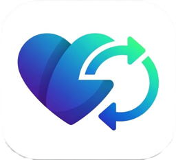
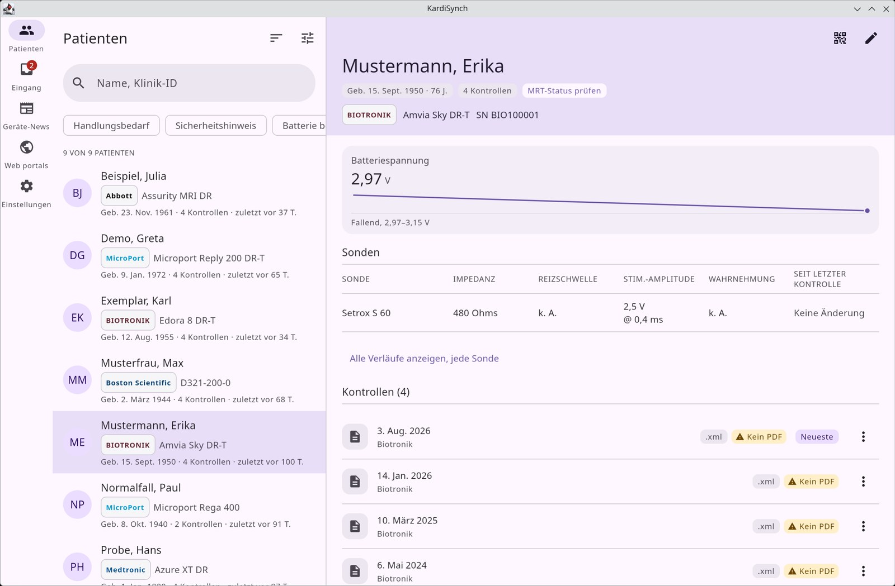
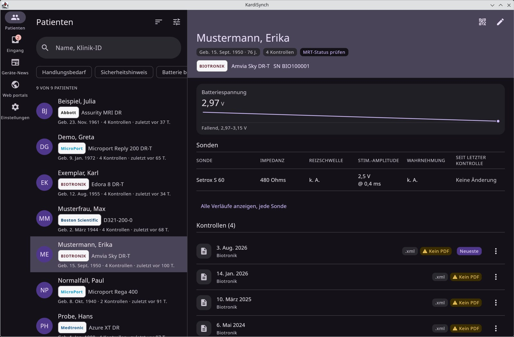
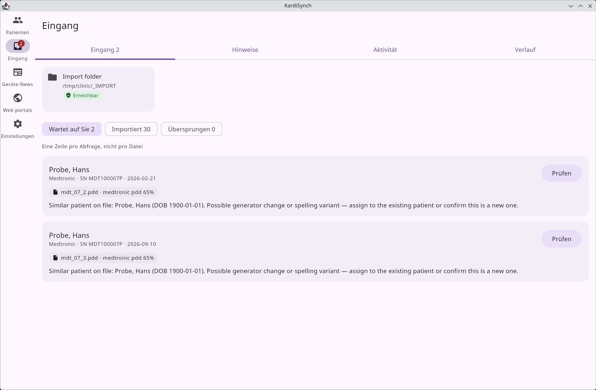
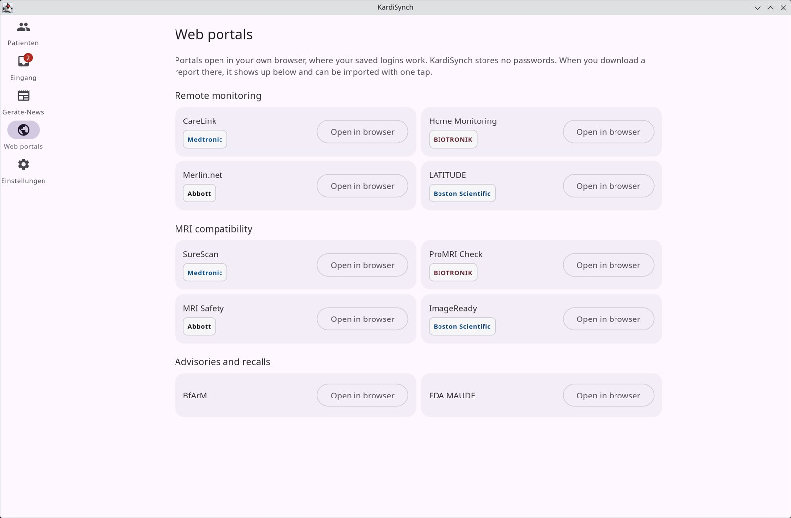
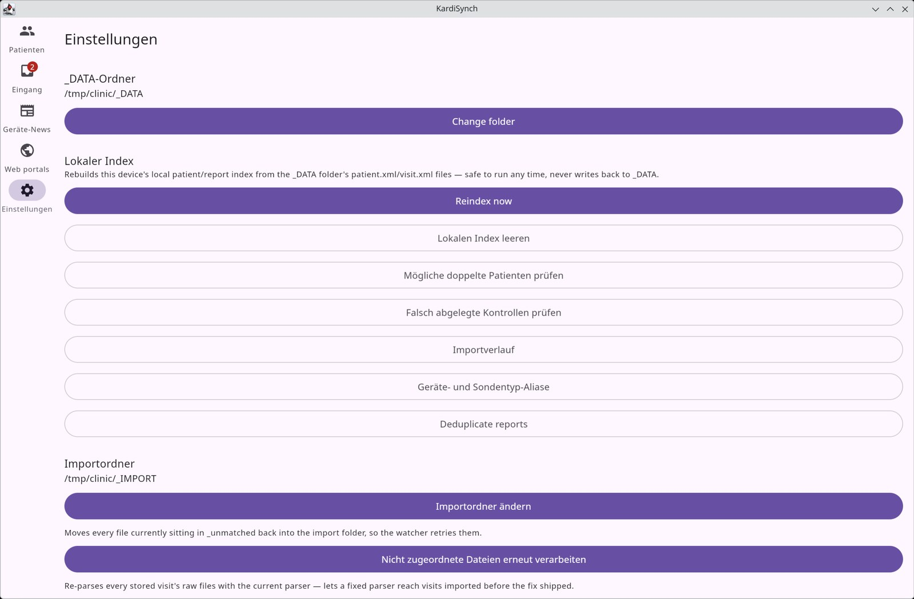

<p align="center">
  
</p>

<h1 align="center">KardiSynch</h1>

<p align="center">
  <strong>Eine Patientendatenbank für alle Hersteller kardialer Implantate.</strong><br>
  Lokal, dateibasiert, ohne Cloud.
</p>

<p align="center">
  <a href="README.md">English</a> · <a href="README.de.md">Deutsch</a>
</p>

<p align="center">
  <a href="https://github.com/alexanderlanganke/KardiSynch/releases/latest"></a>
  <a href="https://github.com/alexanderlanganke/KardiSynch/actions/workflows/kmp-ci.yml"></a>
  
  <a href="LICENSE"></a>
  
</p>

<p align="center">
  
</p>

<p align="center"><sub>Alle Screenshots zeigen erfundene Demo-Patienten aus den Mock-Fixtures des Projekts. Keine echten Patientendaten.</sub></p>

---

Eine Device-Ambulanz hat es mit fünf Herstellern, fünf proprietären Dateiformaten, fünf Web-Portalen und einem Patienten
vor sich zu tun. KardiSynch ist eine native Desktop-App (Windows und Linux) mit Android-Begleiter, die daraus eine einzige
lokale Datenbank macht: Abfrageberichte in einen Ordner legen oder den USB-Stick des Programmiergeräts einstecken.
KardiSynch erkennt die Datei, liest sie aus, ordnet sie dem richtigen Patienten zu und legt sie in dessen Verlauf ab.

Es gibt **keinen Server und kein Cloud-Konto**. Alles liegt in einem lokalen `_DATA`-Ordner als einfache Dateien und XML,
lesbar mit und ohne App. Die SQLite-Datenbank ist nur ein Index und lässt sich jederzeit aus den Dateien neu aufbauen.

## So sieht es aus

### Patienten und Kontrollen

Die ganze Ambulanz durchsuchen und filtern, etwa nach Hersteller, Batteriestatus oder fälliger Kontrolle. Jeder Patient
zeigt Gerät, Batterie- und Sondenverläufe und alle Abfragen auf einer Zeitachse, die Originaldateien neben den
extrahierten Daten.

<p align="center">
  
</p>

### Eingang: nichts wird blind importiert

Jede Abfrage wird nach Fakten gebündelt (Seriennummer, Patient und Tag), nicht nach Dateinamen. Ist KardiSynch sicher,
wird die Kontrolle automatisch abgelegt. Ist es unsicher, etwa bei einer möglichen Schreibvariante oder einem
Aggregatwechsel, wartet das Bündel mit den Hinweisen im **Eingang** und fragt einmal nach. Jede Datei bekommt einen
Verlaufseintrag; nichts geht verloren.

<p align="center">
  
</p>

### Hersteller-Portale im eigenen Browser

Eine Liste für die Fernüberwachungs-Portale (CareLink, Home Monitoring, Merlin.net, LATITUDE), MRT-Kompatibilitätsabfragen
und Sicherheitsmitteilungen. Sie öffnen sich in **Ihrem** Browser, wo Passwortmanager und Sitzungen bereits funktionieren.
KardiSynch bettet keinen Browser ein, liest keine Seiten aus, meldet sich nicht automatisch an und speichert keine
Zugangsdaten. Ein heruntergeladener Bericht wird im Download-Ordner erkannt und zum Import angeboten.

<p align="center">
  
</p>

### Werkzeuge zur Datenpflege

Echte Importe laufen auseinander: doppelt angelegte Patienten, falsch abgelegte Kontrollen, unklare Dateinamen. Dafür
gibt es eingebaute Werkzeuge: Zusammenführen doppelter Patienten, Deduplizierung von Kontrollen, Korrektur falsch
abgelegter Kontrollen, Importverlauf, Geräte- und Sondentyp-Aliase, Neuindizierung und erneutes Einlesen.

<p align="center">
  
</p>

## Funktionen

| | |
|---|---|
| **Fünf Hersteller** | Medtronic, Biotronik, Boston Scientific, Abbott und Microport, erkannt am Inhalt statt an der Dateiendung |
| **Intelligenter Import** | Überwacht einen Importordner (auch Netzlaufwerke und USB-Quellen), wartet bis Dateien fertig sind, bildet SHA-256-Fingerabdrücke und bündelt die Dateien einer Abfrage |
| **Zuordnung, die lernt** | Unsichere Dateien warten in einer dauerhaften Warteschlange; manuelle Korrekturen an Geräten, Sonden und Aliasen werden gemerkt |
| **Klinischer Überblick** | Geräte- und Sondenhistorie, Batteriespannung, Impedanz, Reizschwelle, Wahrnehmung und Arrhythmie-Zusammenfassungen, soweit die Quelldatei sie enthält |
| **Offene Ablage** | `_DATA/Reports/<Patient>/<Kontrolle>/` mit `patient.xml` und `visit.xml`; leicht zu sichern, kein Datenbankserver |
| **Datenpflege** | Doppelte Patienten und Kontrollen, Korrektur falsch abgelegter Kontrollen, erneutes Einlesen, vollständige Neuindizierung aus dem Dateisystem |
| **Links statt Urteile** | Sicherheitsmitteilungen und MRT-Kompatibilität verweisen auf die offiziellen Herstellerseiten |
| **Zweisprachig** | Oberfläche auf Deutsch und Englisch |

### Unterstützte Formate

| Hersteller | Formate |
|---|---|
| **Medtronic** | PDF, XML (in `.pkg`-Archiven), `.pdd` |
| **Biotronik** | XML, PDF |
| **Boston Scientific** | PDF, `.bnk` (auch Exportordner je Patient) |
| **Abbott** | PDF, `.log` |
| **Microport** | XML |

Ausgelesen werden, soweit die Quelldatei sie enthält: Patientenstammdaten, Geräteidentifikation, Sondenparameter,
Batteriestatus, Arrhythmie-Zusammenfassungen und Abfrage-Metadaten.

## Installation

Den aktuellen Installer gibt es auf der [Releases-Seite](https://github.com/alexanderlanganke/KardiSynch/releases/latest):

- **Windows**: `KardiSynch-Setup-<Version>.exe` (oder das portable Zip). Installierte v2.x-Versionen (Electron)
  aktualisieren sich automatisch darauf und übernehmen ihre Ordner und Einstellungen; Patientendaten werden nur gelesen,
  nie verändert.
- **Linux**: Flatpak-Manifest in [`packaging/flatpak`](packaging/flatpak), oder `.deb` / `.rpm` über Gradle.
- **Android**: im internen Test.

Versionen mit Suffix (z. B. `3.0.0-beta.5`) sind Vorabversionen und werden nur angeboten, wenn in den Einstellungen
*Beta-Versionen einbeziehen* aktiviert ist.

### Schnellstart

1. KardiSynch starten und `_DATA`-Ordner und Importordner wählen (Ersteinrichtung, später unter **Einstellungen**).
2. Abfragedateien in den Importordner kopieren oder den USB-Stick des Programmiergeräts einstecken.
3. **Patienten** öffnen. Patienten erscheinen, sobald Dateien gelesen sind; Unsicheres wartet im **Eingang**.

## Aus dem Quellcode bauen

Benötigt ein vollständiges JDK 21 (keine reine JRE).

```bash
git clone https://github.com/alexanderlanganke/KardiSynch.git
cd KardiSynch
./gradlew :apps:desktopApp:run
```

```bash
./gradlew :core:desktopTest :data:desktopTest :apps:desktopApp:desktopTest :ui:desktopTest --continue   # Tests
./gradlew :apps:desktopApp:packageDistributionForCurrentOS                                              # Installer für dieses OS
./gradlew ktlintCheck                                                                                    # Stil
```

## Architektur

```
core/        plattformfreie Logik: Parser (einer je Hersteller) -> UnifiedReport, Intake (Erkennen, Fakten, Bündeln),
             Zuordnung, Deduplizierung, das _DATA-Layout, News, MRT-Abfragen, QR-Import
data/        SQLDelight-Schema und KardiSynchRepository
ui/          Compose-Oberflächen: Dashboard, Patientendetail, Eingang, Zuordnung, Duplikate, Einstellungen, Portale, ...
apps/
  desktopApp/  Import-Watcher, USB-Watcher, Updater, Desktop-Einstiegspunkt
  androidApp/  Android-Shell
packaging/   Windows-Installer, Flatpak
```

Alle Parser erzeugen einen `UnifiedReport`. Dateien werden nach Fakten zu Bündeln gruppiert, je Bündel einmal aufgelöst
und unter `_DATA/Reports/<Patient>/<Kontrolle>/` abgelegt. Details: [`docs/intake-pipeline.md`](docs/intake-pipeline.md)
(englisch).

| Schicht | Technik |
|---|---|
| Sprache / UI | [Kotlin Multiplatform](https://kotlinlang.org/docs/multiplatform.html), [Compose Multiplatform](https://www.jetbrains.com/compose-multiplatform/) |
| Zielplattformen | Desktop (JVM) und Android |
| Datenbank | SQLite über [SQLDelight](https://sqldelight.github.io/sqldelight/), nur Index; Quelle der Wahrheit ist das Dateisystem |
| PDF | [Apache PDFBox](https://pdfbox.apache.org/) (Textextraktion) |
| Build / CI | Gradle, jpackage (Windows-Installer und Flatpak), GitHub Actions |

## Hinweis zur Regulierung

**KardiSynch ist kein Medizinprodukt und nicht für klinische Entscheidungen vorgesehen.**

Die Software ist ein Werkzeug zur Datenverwaltung und Organisation. Sie gibt keine medizinischen Ratschläge, Diagnosen
oder Therapieempfehlungen.

- **Das Auslesen** beruht auf heuristischer Extraktion aus Herstellerdateien. Extrahierte Daten können Fehler enthalten und dürfen nicht die einzige Quelle klinischer Informationen sein.
- **MRT-Kompatibilität** muss von der verantwortlichen Ärztin bzw. dem verantwortlichen Arzt mit den offiziellen Herstellerwerkzeugen geprüft werden.
- **Sicherheitsmitteilungen** verlinken auf Herstellerwebsites und können unvollständig oder verzögert sein. Im Zweifel beim Hersteller und den zuständigen Behörden nachfragen.
- **Die Portal-Liste** öffnet Herstellerwebsites nur im eigenen Browser. KardiSynch automatisiert keine Anmeldungen, sendet keine Formulare und speichert keine Zugangsdaten.
- **Klinische Entscheidungen** müssen von qualifiziertem medizinischem Fachpersonal auf Grundlage geprüfter Quelldaten getroffen werden.

Die Software ist nicht nach einer Medizinprodukte-Verordnung (u. a. EU-MDR 2017/745, FDA 21 CFR 820) zertifiziert,
zugelassen oder freigegeben. Sie wird ohne Gewähr zu Organisationszwecken bereitgestellt.
