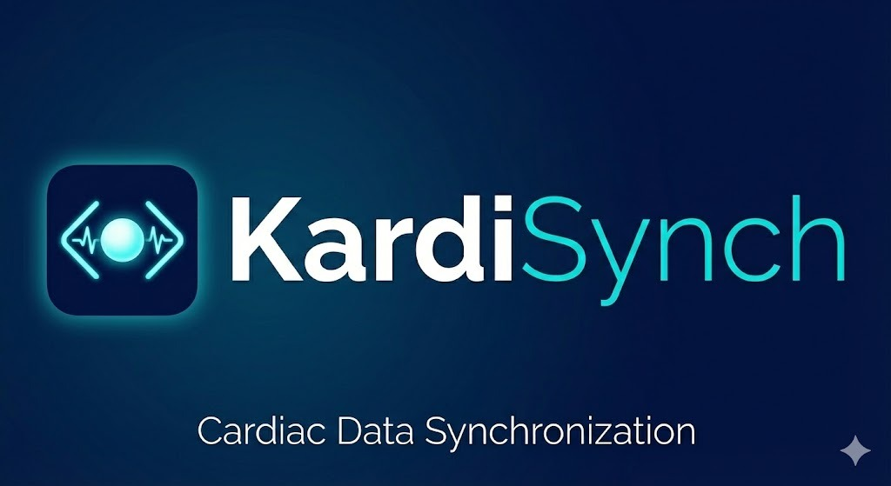

<p align="center">
  
</p>

<h1 align="center">KardiSynch</h1>

<p align="center">
  <strong>One patient database for every cardiac device manufacturer</strong>
</p>

<p align="center">
  <a href="https://github.com/alexanderlanganke/KardiSynch/releases/latest"></a>
  <a href="https://github.com/alexanderlanganke/KardiSynch/actions/workflows/kmp-ci.yml"></a>
  
  <a href="https://github.com/alexanderlanganke/KardiSynch/blob/main/LICENSE"></a>
  
</p>

---

Every EP lab juggles the same problem: five manufacturers, five proprietary file formats, five web portals, and one patient in front of you. KardiSynch collapses that into a single local database — drop a file in (or plug in a programmer's USB drive), and it's parsed, matched to the right patient, and filed on a timeline next to everything else they've ever had implanted.

No server. No cloud account. No vendor lock-in — your data is plain files and XML on disk, readable with or without the app.

## Who is this for?

- **Cardiac device clinics** managing interrogation follow-ups across multiple manufacturer ecosystems
- **Electrophysiology departments** that need a unified view of patient device history
- **Clinical engineers** working with reports from Medtronic, Biotronik, Boston Scientific, Abbott, and Microport

## Key Features

### Multi-Manufacturer Import

Automatically parses interrogation files from five manufacturers:

| Manufacturer | Supported Formats |
|---|---|
| **Medtronic** | PDF, XML (via `.pkg` archives), `.pdd` binary |
| **Biotronik** | XML, PDF |
| **Boston Scientific** | PDF, `.bnk` binary |
| **Abbott** | PDF, `.log` (DOCX) |
| **Microport** | XML |

Files are detected, parsed, and matched to patients automatically. Unmatched files trigger an interactive assignment dialog — and every manual correction is remembered, so KardiSynch gets quieter over time instead of asking the same question twice.

### Manufacturer portals

One list of the remote-monitoring portals (CareLink, Home Monitoring, Merlin.net, LATITUDE), MRI-compatibility lookups and
advisory pages — no more hunting for four bookmarks.

- Portals open in **your own browser**, where your password manager and saved sessions already work. KardiSynch does not
  embed a browser, scrape, auto-login or script the sites, and stores no credentials.
- A report you download is picked up from the downloads folder and offered for import into the same pipeline as files
  dropped on disk.

### Structured Patient Database

- Filesystem-based storage (`Reports/PatientID/VisitID/`) — portable, easy to back up, no database server needed
- SQLite index for fast search and filtering
- XML metadata files (`patient.xml`, `visit.xml`) generated per visit for interoperability
- Full-text search across patient names, device serials, and hospital IDs

### USB & Directory Monitoring

- Watches a configurable import directory for new files
- Optional USB source/target monitoring for direct device reader import
- File stability checks and copy verification prevent partial imports
- Only processes supported file types — ignores noise

### Clinical Data Extraction

Parsed data includes (where available in the source file):

- Patient demographics (name, DOB, hospital ID)
- Device identification (manufacturer, model, serial, type)
- Lead parameters (impedance, sensing, pacing threshold)
- Battery status (voltage, longevity, ERI/EOL indicators)
- Arrhythmia summaries (AF burden, VT episode counts)
- Interrogation metadata (date, session ID, hospital visit ID)

### Data Management Tools

Real-world imports drift — duplicate registrations, ambiguous filenames, files that land in the wrong place. KardiSynch treats cleanup as a first-class feature, not an afterthought:

- **Visit Timeline** — chronological view of all interrogations per patient
- **Side-by-Side Viewer** — original PDF alongside structured extracted data
- **Rescan Visit** — re-parse existing files with conflict resolution merge dialog
- **Move Visit** — reassign visits between patients
- **Device & Lead Editor** — manually edit device and lead history, with corrections remembered for future imports of the same model
- **Duplicate Patient Detection** — finds and merges patient records that were accidentally created twice, without splitting their visit history
- **Deduplication Tool** — finds and merges duplicate visits at both the database and filesystem level
- **Orphan Catcher** — detects and repairs visits that ended up filed under the wrong patient
- **Pending Sort Queue** — unmatched files wait in a persistent queue for review, individually or in bulk, instead of blocking the import pipeline
- **Database Rebuild** — full re-index from filesystem

### Manufacturer Advisory Links

Links to manufacturer advisory portals are surfaced directly on patient cards when applicable. KardiSynch does not determine advisory status — it provides direct links to official manufacturer resources for manual verification.

### MRI Compatibility Links

Quick-access links to manufacturer MRI compatibility check tools (Medtronic SureScan, Biotronik ProMRI, Abbott MerlinMRI, Boston Scientific ImageReady). MRI compatibility must always be verified by the responsible physician using official manufacturer resources.

## Installation

### Download

Get the latest installer from the [Releases page](https://github.com/alexanderlanganke/KardiSynch/releases/latest):

- **Windows**: `KardiSynch-Setup-<version>.exe` (or the portable zip). Installed v2.x (Electron) copies update to it
  automatically and take over their data.
- **Linux**: Flatpak manifest in [`packaging/flatpak`](packaging/flatpak), or `.deb`/`.rpm` via Gradle.
- **Android**: in internal testing.

Versions with a suffix (`3.0.0-beta.4`) are pre-releases, offered only if you tick "Include beta versions" in Settings.

### Quick Start

1. Launch KardiSynch
2. Configure your import directory in **Settings > Paths**
3. Drop interrogation files into the import directory (or plug in a USB drive from a programmer)
4. Open the dashboard — patients appear automatically as files are parsed; anything uncertain waits in the **Inbox**

## Building from Source

Requires a full JDK 21.

```bash
git clone https://github.com/alexanderlanganke/KardiSynch.git
cd KardiSynch
./gradlew :apps:desktopApp:run
```

### Development

```bash
./gradlew :core:desktopTest :data:desktopTest :apps:desktopApp:desktopTest :ui:desktopTest   # tests
./gradlew :apps:desktopApp:packageDistributionForCurrentOS                                   # installer for this OS
./gradlew ktlintCheck                                                                         # style
```

## Technology

| Layer | Stack |
|---|---|
| Language / UI | [Kotlin Multiplatform](https://kotlinlang.org/docs/multiplatform.html), [Compose Multiplatform](https://www.jetbrains.com/compose-multiplatform/) |
| Targets | Desktop (JVM) and Android |
| Database | SQLite via [SQLDelight](https://sqldelight.github.io/sqldelight/) — index only, the source of truth is the filesystem |
| PDF | [Apache PDFBox](https://pdfbox.apache.org/) (text extraction) |
| Build | Gradle, jpackage (Windows NSIS installer, Flatpak) |
| CI/CD | GitHub Actions — tests, Android compile check, Windows build and release |

## Architecture

```
core/        platform-free logic: parsers (one per manufacturer) -> UnifiedReport, intake (identify, facts, bundle),
             matching, dedup, the _DATA layout, news, MRI lookups, QR import
data/        SQLDelight schema and KardiSynchRepository
ui/          Compose screens (dashboard, patient detail, inbox, pending sort, duplicates, settings, ...)
apps/
  desktopApp/  import watcher, USB watcher, updater, desktop entry point
  androidApp/  Android shell
packaging/   Windows installer, Flatpak
```

All parsers produce a `UnifiedReport`. Files are grouped into bundles by facts (device serial, patient and day), resolved
once per bundle, and stored under `_DATA/Reports/<patient>/<visit>/`. See
[`docs/intake-pipeline.md`](docs/intake-pipeline.md).

---

## Regulatory Notice

**KardiSynch is not a medical device and is not intended for clinical decision-making.**

This software is a data management and organizational tool. It does not provide medical advice, diagnoses, or treatment recommendations.

- **Patient data parsing** uses heuristic extraction from manufacturer files. Extracted data may contain errors and must not be used as the sole source of clinical information.
- **MRI compatibility** must be independently verified by the responsible physician using the manufacturer's official tools and documentation.
- **Device advisories** shown in this application link to manufacturer websites and may be incomplete or delayed. Always consult the manufacturer directly and relevant regulatory authorities for authoritative safety information.
- **The portal list** only opens manufacturer websites in your own browser: KardiSynch does not automate logins, submit forms, store credentials, or interact with manufacturer portals on your behalf. All authentication and data retrieval actions are performed manually by the user.
- **Clinical decisions** regarding patient care, device programming, or procedural planning must be made by qualified healthcare professionals based on verified source data.

This software has not been certified, cleared, or approved under any medical device regulation (including EU MDR 2017/745, FDA 21 CFR 820, or equivalent). It is provided as-is for organizational purposes only.
