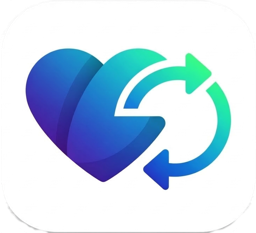
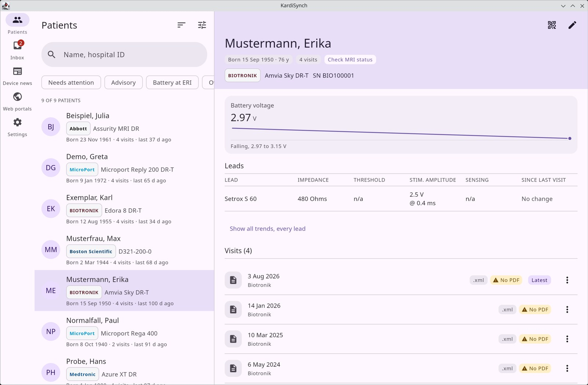
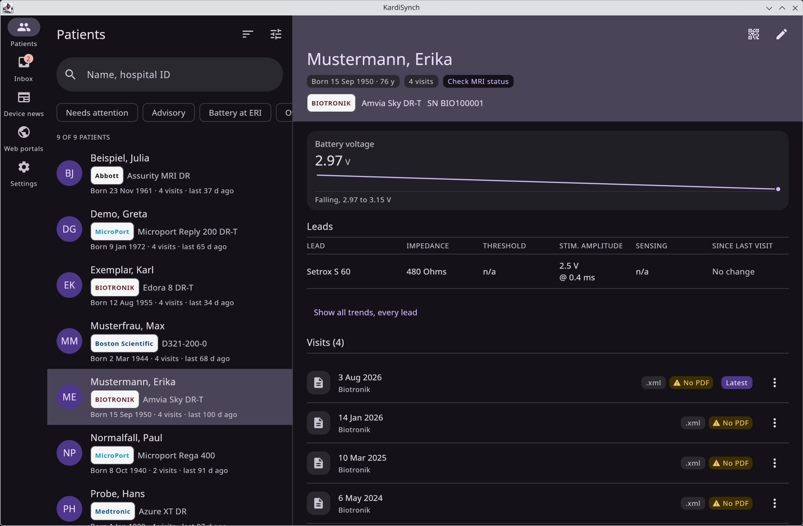
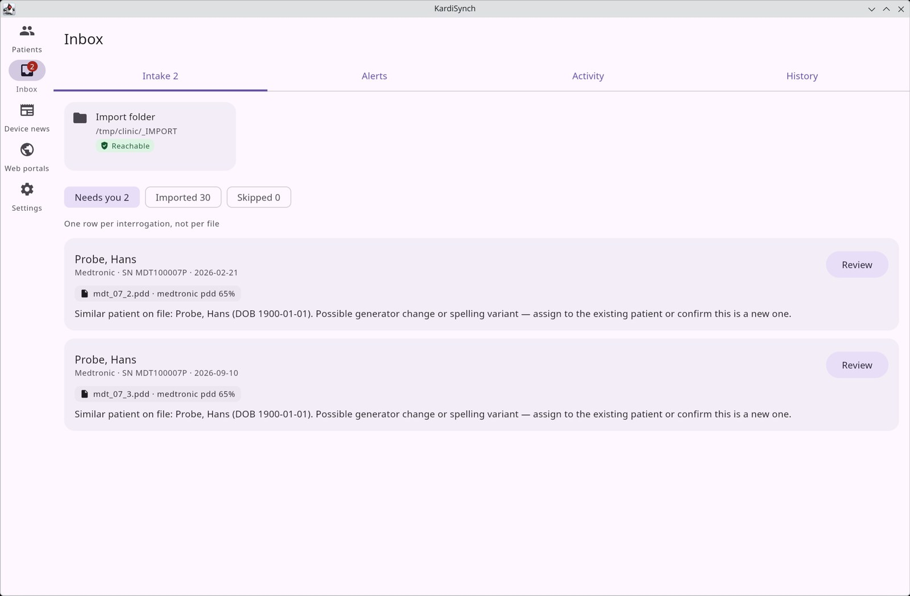
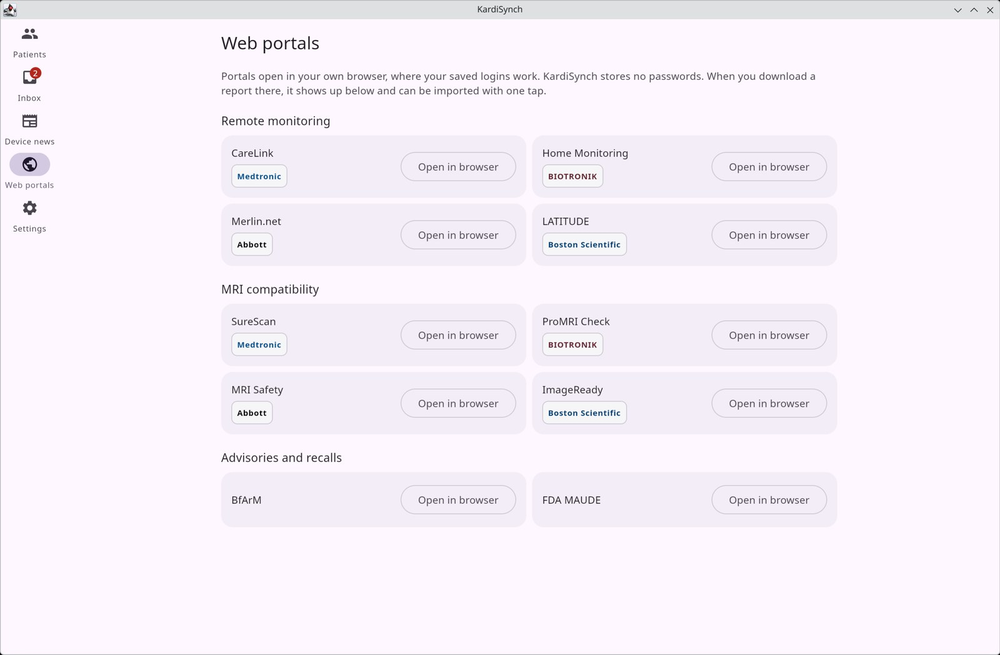
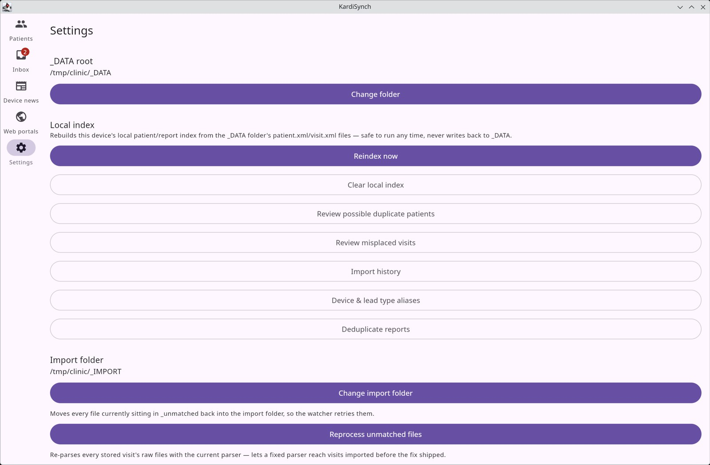

<p align="center">
  
</p>

<h1 align="center">KardiSynch</h1>

<p align="center">
  <strong>One patient database for every cardiac device manufacturer.</strong><br>
  Local, file-based, no cloud.
</p>

<p align="center">
  <a href="README.md">English</a> · <a href="README.de.md">Deutsch</a>
</p>

<p align="center">
  <a href="https://github.com/alexanderlanganke/KardiSynch/releases/latest"></a>
  <a href="https://github.com/alexanderlanganke/KardiSynch/actions/workflows/kmp-ci.yml"></a>
  
  <a href="LICENSE"></a>
  
</p>

<p align="center">
  
</p>

<p align="center"><sub>All screenshots show invented demo patients generated by the project's mock fixtures. No real patient data.</sub></p>

---

A cardiac device clinic deals with five manufacturers, five proprietary file formats, five web portals and one patient in
front of you. KardiSynch is a native desktop app (Windows and Linux) with an Android companion that turns this into a single
local database: drop an interrogation report into a folder, or plug in a programmer's USB stick. KardiSynch identifies
the file, parses it, matches it to the right patient and files it on that patient's timeline.

There is **no server and no cloud account**. Everything lives in a local `_DATA` folder as plain files and XML, readable
with or without the app. A SQLite database is only an index and can be rebuilt from the files at any time.

## What it looks like

### Patients and visits

Search and filter the whole clinic by manufacturer, battery status or follow-up due date. Each patient shows the device,
battery and lead trends and every interrogation on one timeline, with the original files next to the extracted data.

<p align="center">
  
</p>

### Inbox: nothing is imported blindly

Every interrogation is grouped by facts (serial number, patient and day), not by file name. When KardiSynch is confident,
the visit is filed automatically. When it is not, for example a possible spelling variant or a generator change, the
bundle waits in the **Inbox** with the evidence and asks you once. Every file gets a history entry; nothing vanishes.

<p align="center">
  
</p>

### Manufacturer portals, in your own browser

One list for the remote-monitoring portals (CareLink, Home Monitoring, Merlin.net, LATITUDE), MRI compatibility lookups
and advisory pages. They open in **your** browser, where your password manager and sessions already work. KardiSynch
does not embed a browser, scrape, auto-login or store credentials. A report you download is picked up from the downloads
folder and offered for import.

<p align="center">
  
</p>

### Maintenance tools

Real-world imports drift. Duplicate registrations, misfiled visits and unclear file names are handled by built-in tools:
duplicate patient merge, visit deduplication, misplaced-visit repair, import history, device and lead aliases, re-index
and re-parse.

<p align="center">
  
</p>

## Features

| | |
|---|---|
| **Five manufacturers** | Medtronic, Biotronik, Boston Scientific, Abbott and Microport, identified by content rather than file extension |
| **Smart intake** | Watches an import folder (also network shares and USB sources), waits for files to settle, fingerprints them (SHA-256) and groups the files of one interrogation |
| **Matching that learns** | Uncertain files wait in a persistent queue; manual corrections to devices, leads and aliases are remembered |
| **Clinical overview** | Device and lead history, battery voltage, impedance, threshold, sensing and arrhythmia summaries where the source file has them |
| **Open storage** | `_DATA/Reports/<patient>/<visit>/` with `patient.xml` and `visit.xml`; easy to back up, no database server |
| **Maintenance** | Duplicate patients and visits, orphan repair, re-parse, full re-index from the filesystem |
| **Links, not verdicts** | Advisory and MRI-compatibility pages are linked to the official manufacturer resources |
| **Bilingual** | German and English user interface |

### Supported formats

| Manufacturer | Formats |
|---|---|
| **Medtronic** | PDF, XML (inside `.pkg` archives), `.pdd` |
| **Biotronik** | XML, PDF |
| **Boston Scientific** | PDF, `.bnk` (including per-patient export folders) |
| **Abbott** | PDF, `.log` |
| **Microport** | XML |

Parsed data includes, where the source file provides it: patient demographics, device identification, lead
parameters, battery status, arrhythmia summaries and interrogation metadata.

## Installation

Get the latest installer from the [Releases page](https://github.com/alexanderlanganke/KardiSynch/releases/latest):

- **Windows**: `KardiSynch-Setup-<version>.exe` (or the portable zip). Installed v2.x (Electron) copies update to it
  automatically and take over their folders and settings; patient data is only read, never changed.
- **Linux**: Flatpak manifest in [`packaging/flatpak`](packaging/flatpak), or `.deb` / `.rpm` via Gradle.
- **Android**: in internal testing.

Versions with a suffix (for example `3.0.0-beta.5`) are pre-releases, offered only if you tick *Include beta versions*
in Settings.

### Quick start

1. Start KardiSynch and choose your `_DATA` folder and import folder (first-run setup, later in **Settings**).
2. Copy interrogation files into the import folder, or plug in a USB stick from a programmer.
3. Open **Patients**. Patients appear as files are parsed; anything uncertain waits in the **Inbox**.

## Building from source

Requires a full JDK 21 (not a JRE-only install).

```bash
git clone https://github.com/alexanderlanganke/KardiSynch.git
cd KardiSynch
./gradlew :apps:desktopApp:run
```

```bash
./gradlew :core:desktopTest :data:desktopTest :apps:desktopApp:desktopTest :ui:desktopTest --continue   # tests
./gradlew :apps:desktopApp:packageDistributionForCurrentOS                                              # installer for this OS
./gradlew ktlintCheck                                                                                    # style
```

## Architecture

```
core/        platform-free logic: parsers (one per manufacturer) -> UnifiedReport, intake (identify, facts, bundle),
             matching, dedup, the _DATA layout, news, MRI lookups, QR import
data/        SQLDelight schema and KardiSynchRepository
ui/          Compose screens: dashboard, patient detail, inbox, pending sort, duplicates, settings, portals, ...
apps/
  desktopApp/  import watcher, USB watcher, updater, desktop entry point
  androidApp/  Android shell
packaging/   Windows installer, Flatpak
```

All parsers produce a `UnifiedReport`. Files are grouped into bundles by facts, resolved once per bundle and stored under
`_DATA/Reports/<patient>/<visit>/`. Details: [`docs/intake-pipeline.md`](docs/intake-pipeline.md).

| Layer | Stack |
|---|---|
| Language / UI | [Kotlin Multiplatform](https://kotlinlang.org/docs/multiplatform.html), [Compose Multiplatform](https://www.jetbrains.com/compose-multiplatform/) |
| Targets | Desktop (JVM) and Android |
| Database | SQLite via [SQLDelight](https://sqldelight.github.io/sqldelight/), index only; the filesystem is the source of truth |
| PDF | [Apache PDFBox](https://pdfbox.apache.org/) (text extraction) |
| Build / CI | Gradle, jpackage (Windows installer, Flatpak), GitHub Actions |

## Regulatory notice

**KardiSynch is not a medical device and is not intended for clinical decision-making.**

This software is a data management and organizational tool. It does not provide medical advice, diagnoses or treatment
recommendations.

- **Parsing** uses heuristic extraction from manufacturer files. Extracted data may contain errors and must not be the sole source of clinical information.
- **MRI compatibility** must be verified by the responsible physician using the manufacturer's official tools.
- **Device advisories** link to manufacturer websites and may be incomplete or delayed. Consult the manufacturer and the relevant authorities.
- **The portal list** only opens manufacturer websites in your own browser. KardiSynch does not automate logins, submit forms or store credentials.
- **Clinical decisions** must be made by qualified healthcare professionals based on verified source data.

The software has not been certified, cleared or approved under any medical device regulation (including EU MDR 2017/745
or FDA 21 CFR 820). It is provided as-is for organizational purposes.
